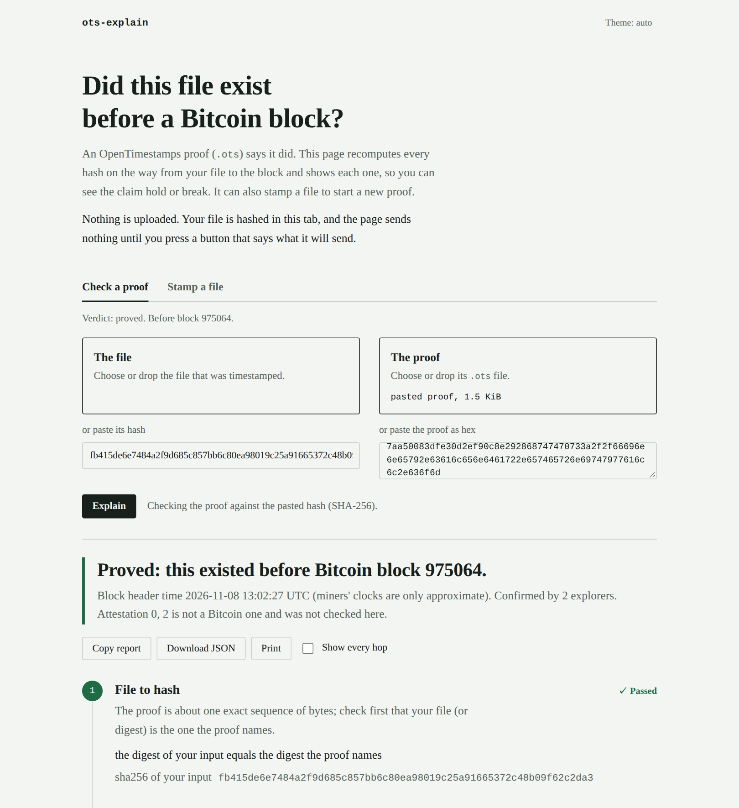

# ots-explain



*A real stamp from 2026-11-08, checked in the page against two public explorers (`./podman.sh hero` retakes this picture).*

Check, understand and create [OpenTimestamps](https://opentimestamps.org/) proofs in one place: open a `.ots` proof and
see **every hop** from your file to a Bitcoin block, or stamp a file and upgrade it later, with the file never leaving
your machine. Two **independent implementations of one written spec** must print byte-identical reports:

* `dist/index.html`: one static page (73 KB, no dependencies, works from `file://`, nothing uploaded).
* `python/verify_ots.py`: one stdlib-only Python script (≥ 3.9) with the same five steps.

The page does both halves: **check** a proof and **stamp** a file (hash it in the tab, ask the public calendars,
download the pending `.ots`, upgrade it later, check it). The script does the same from a terminal or cron.
Both walk the same five steps and end in a verdict that is green **only** when every check passed and none was skipped.

1. **File to hash**: your file (or pasted hash) against the digest the proof names.
2. **Proof structure**: the `.ots` parsed with strict limits; every error has a name.
3. **Hash steps**: every operation recomputed from your digest, grouped into the calendar's tree, the Bitcoin transaction and the block's merkle path.
4. **The ledger**: only on request. The URLs are listed first. Two Esplora servers (blockstream.info, mempool.space) plus a base URL of your own.
5. **Verdict**: "this file existed before block N", or "not proven yet", or "a check failed".

## Run it

```sh
# the page: open it, or serve it
npm install && npm run build        # writes dist/index.html
open dist/index.html                # drop a file and its .ots on it, or paste the file's hash and the proof's hex

# the script (no install, standard library only)
python3 python/verify_ots.py report.pdf report.pdf.ots              # offline: steps 1-3
python3 python/verify_ots.py report.pdf report.pdf.ots --steps      # every digest after every operation
python3 python/verify_ots.py report.pdf.ots --digest 945a…877f      # no file, just its hash
python3 python/verify_ots.py report.pdf report.pdf.ots --yes        # also ask the explorers (lists URLs first)
python3 python/verify_ots.py a b --esplora https://my.esplora/api   # your own server instead of the defaults
python3 python/verify_ots.py a b --json                             # canonical JSON (schema: spec/report.schema.json)
```

Exit codes: `0` proved, `1` a check failed, `3` something was not checked (so: not proved), `2` usage or input error.

### Stamping in the page

"Stamp a file" hashes the file in the tab (streamed in chunks, never uploaded), shows the exact requests it will make
(`POST <calendar>/digest` with a 32-byte body) and waits for you to press the button. The body is
`SHA-256(file hash ‖ 16 random bytes)`; the random bytes go only into your `.ots`. Download the pending proof,
come back in a few hours, open it under "Check a proof", press "Ask the calendar" (only calendars the page knows, or
one you add, are asked), download the upgraded `.ots`, and check the ledger. A browser can only read a calendar's
answer if the calendar sends CORS headers. Checked against the real calendars on 2026-11-08: the answer that carries the
Bitcoin path (HTTP 200) is readable from the page, but the "not confirmed yet" answer (HTTP 404) has no CORS header, so
while a proof is still pending the page shows "unreachable: Failed to fetch" instead of "not yet". That is the browser
refusing to show the answer, not a failed request. The script has no such limit.

### Stamping and the cron check (script, run by you)

```sh
python3 python/ots_stamp.py stamp report.pdf          # shows the calendar URLs, asks, then writes report.pdf.ots (pending)
python3 python/ots_stamp.py upgrade report.pdf.ots    # in a few hours: asks the calendar for the Bitcoin path
python3 python/ots_stamp.py watch ~/proofs --ledger   # for cron/systemd: upgrades pending proofs, checks confirmed ones
```

Only `SHA-256(your digest ‖ 16 random bytes)` is sent to a calendar, never the file or its hash.
`contrib/` has a crontab line and a systemd timer. Nothing schedules itself.

### Everything in Podman (nothing installed on the host)

`./podman.sh` is the only entry point; the host needs Podman (or `CONTAINER=docker`) and this folder. It was run for real
on 2026-11-08 with Podman 5.8 on macOS (`tools/e2e_real.sh`): the `ci`, `test` and `runtime` images build, and the tests
pass inside them. That run found a number of bugs, all fixed (see `CHANGELOG.md`).

```sh
./podman.sh test                  # typecheck, build, all tests, conformance, fuzz, browser smoke (Chromium inside)
./podman.sh build                 # writes ./dist/index.html and ./dist/ots-explain-core.mjs
./podman.sh serve                 # the page on http://localhost:8080/
./podman.sh cli verify report.pdf report.pdf.ots --steps      # also: cli stamp FILE, cli upgrade PROOF
OTS_API_TOKEN=s3cret ./podman.sh api --allow-network          # the REST API on 127.0.0.1:8787
./podman.sh live-check --yes      # the real-world checks from docs/GOING-ONLINE.md, also in a container
GH_TOKEN=... ./podman.sh repo     # create the private GitHub repo from a container
./podman.sh clean                 # remove the images
```

Files are written only to `./dist`, `./vectors/explorer` (record) and `./.git` (repo), and next to the files you give `cli`.

### Use it as an API (Python backend, from JS or anything else)

`python/ots_api.py` is a small REST server (standard library only) around the same code as the script. It takes
**digests, never files**. By default it listens on `127.0.0.1`, does nothing on the network, and has no CORS.

```sh
python3 python/ots_api.py                                  # http://127.0.0.1:8787, offline: verify steps 1-3, permalinks
python3 python/ots_api.py --allow-network                  # also: ledger checks, /v1/stamp, /v1/upgrade
python3 python/ots_api.py --allow-network --esplora-allow https://my.esplora/api --calendar-allow https://my.calendar
python3 python/ots_api.py --cors https://my.app --token s3cret   # let one web origin call it; require a bearer token
podman run --rm -p 127.0.0.1:8787:8787 -e OTS_API_TOKEN=s3cret ots-explain api --allow-network
```

| Endpoint | Body (JSON) | Answer |
|---|---|---|
| `GET /v1/health` | | `{ok, network, version, report_spec}` |
| `POST /v1/verify` | `{proof_b64, digest?, ledger?: true \| {servers:[url]}, steps?}` or the raw `.ots` as `application/octet-stream` with `?digest=` | the report, byte-identical to `verify_ots.py --json`; `X-Verdict` header; `?format=text` for the readable one |
| `POST /v1/stamp` | `{digest, calendars?}` | `{proof_b64, status:"pending", log}` |
| `POST /v1/upgrade` | `{proof_b64}` | `{proof_b64, changed, status, log}` |
| `POST /v1/permalink`, `/v1/permalink/decode` | `{digest, proof_b64, base, proof_url?}` / `{url}` | the link / its parts |

The full contract is `spec/openapi.json` (served at `/openapi.json`; a test checks it against the routes).
Errors are `{"error": {"code", "message"}}` with 400, 401, 403, 404, 411, 413 or 500. A proof that does not parse is
**not** an HTTP error: you get a report whose verdict is `FAIL`. Guards: ledger servers and calendars named in a
request must be on the allow-list (the defaults plus `--esplora-allow` / `--calendar-allow`), so a caller cannot make
the server fetch arbitrary URLs; bodies are capped at 16 MiB; bodies are never logged; listening on anything but
loopback needs `--token`. It is a helper for your own tools, not a hardened public service.

```sh
curl -s localhost:8787/v1/verify -H 'content-type: application/json' \
  -d "{\"proof_b64\": \"$(base64 -w0 report.pdf.ots)\", \"digest\": \"$(sha256sum report.pdf | cut -d' ' -f1)\"}"
```

```js
import { OtsApi, sha256Hex } from "./clients/js/ots-api.mjs";   // browser or Node >= 18, no dependencies
const api = new OtsApi("http://127.0.0.1:8787", { token: "s3cret" });
const report = await api.verify({ proof: otsBytes, digest: await sha256Hex(fileBytes) });
const { proof } = await api.stamp({ digest: await sha256Hex(fileBytes) });   // needs --allow-network
```

```python
from ots_client import OtsApi                                  # clients/python/ots_client.py, urllib only
api = OtsApi("http://127.0.0.1:8787")
report = api.verify(open("report.pdf.ots", "rb").read(), digest_hex)
```

#### Use it as a library (no server)

```python
import sys; sys.path.insert(0, "python")
import verify_ots as V
report = V.build_report(open("a.ots", "rb").read(), digest_hex="945a...877f")   # dict
print(V.canonical_json(report))
```

```js
import { buildReport, canonicalJson } from "./dist/ots-explain-core.mjs";   // built by `npm run build`
const report = await buildReport({ proof: otsBytes, digestHex });
console.log(canonicalJson(report));
```

### Links that remember a check

`PAGE#h=<sha256-hex>&ots=<base64url proof>`, optionally with `PAGE?proof=<url>`. The fragment never leaves the
browser. A `?proof=` URL is fetched only after you click the button on the page. `verify_ots.py --link PAGE` prints one.

## Donating to the calendars

Stamping costs the calendar operators Bitcoin fees; opentimestamps.org says they rely on donations (bitcoin, some
also Lightning). The page links to each calendar's own home page, where its wallet address is shown, and carries **no
address of its own**: an address copied into a README or a page can go stale or be swapped in a fork. This project
takes no donations.

## Privacy

* The page makes **no network request** until you press a button that names what it will do: "Ask these servers", "Send to the calendars", "Ask the calendar", or "Fetch the proof" for a `?proof=` link. Its CSP is `default-src 'none'`, no `unsafe-*`, no eval; there are no third-party scripts, fonts, analytics or images.
* Your file is hashed in the tab and is never sent anywhere. Nor are its hash or the proof: the explorers receive only a block height, a block hash and a transaction id, all public; a calendar receives only the commitment `SHA-256(hash ‖ random)`. They do see your IP address.
* The script is offline by default; with `--yes` it prints the URLs and then calls them (GET only).
* Nothing is stored. The page keeps only the theme (in `localStorage`, if available).

## How it compares

Checked: `otskit` 0.1.0's PyPI page (stdlib-only, opt-in `--esplora`, checks proof of work and that the header hashes to the block hash, says itself it is not SPV). Also read on 2026-11-08 (their own pages, one visit each): two hosted tools, one that verifies a proof (it hashes in your browser but compares the hash on its server) and one that stamps (it receives only the hash; its source was not stated). Not re-checked for this README: how the official `ots` client and the official web page verify today; the JavaScript client's verification route. Read their docs before relying on this table.

| | ots-explain | otskit (as read) | official `ots` / JS client / web page |
|---|---|---|---|
| shows every hop and the three phases | yes | not documented | no (prints a summary) |
| checks the transaction is in the block, the raw tx matches the proof, an output carries the commitment | yes (via Esplora) | not documented | not re-checked |
| two servers must agree | yes | "several servers = several opinions" | not re-checked |
| runs in a browser, offline, no upload | yes | n/a | the web page: not re-checked |
| second, independent implementation diffed on every vector | yes (535 cases, 0 diffs; stamp/upgrade bytes and logs diffed too) | no | no |
| SPV (header chain, difficulty) | **no** | no | needs your own node for full independence |

What this adds is **explanation, stamping and verifying in one open tool that sends nothing but a commitment or an explorer query, plus cross-checking**; it is not a stronger trust model. Hosted tools exist for single jobs (verify, or stamp); I found none that shows each hop, runs offline and is open source, but that is a few searches, not a survey.

## What a green verdict means

See `docs/THREAT-MODEL.md`. In one line: *these bytes existed by that block, if the explorers you asked are honest*; not SPV, no identity, pending proofs never go green.

## Known limits

* **Not SPV.** A server that lies consistently, or two that collude, would pass. Proof of work is checked against the header's own `nBits`, not against the real chain's difficulty. For independence, compare the block hash with your own node.
* The explorer data in `vectors/explorer/synthetic*` is **synthetic** (built around each proof so the code paths run); the unit and conformance tests use it. Real explorers were asked once, on 2026-11-08 (`podman.sh live-check --yes`): blockstream.info and mempool.space agreed with the expected verdict on all seven official vectors asked (six PASS, one expected FAIL), and on the real proof listed next. Real recordings under `vectors/explorer/recorded-*` have not been made (`tools/record_explorer.py --yes`).
* Real calendars were contacted on 2026-11-08: alice, bob and finney accepted a stamp from the script and from the page; the block that holds it is 975064 (header time 13:02 UTC, 22 minutes after the stamp); alice's answer was first seen at a poll 77 minutes after the stamp (the poll before, at 2 minutes, got "not yet"), and bob and finney still said "not yet" at that poll. The upgrade was done by the script and, separately, by the page's "Ask the calendar"; both proofs verify against both explorers. `vectors/real/` holds that file and its proof before and after. One proof, one day, three calendars: it shows the path works, not how long calendars usually take.
* The browser cannot read a calendar's "not confirmed yet" answer (no CORS header on the 404, see above), so a pending proof shows "unreachable" on the page, not "not yet".
* Only Bitcoin attestations are checked; Litecoin, Ethereum and unknown ones are shown and marked "not checked". `ripemd160`-headed proofs need `--digest`/pasted hash (files are hashed with SHA-256/SHA-1).
* The page's UI code is covered by a browser smoke test, not by line coverage.

See `docs/BACKLOG.md` for what is not done, ranked.

## Layout and tests

```
spec/      SPEC.md (normative), report.schema.json, steps.json, openapi.json, QUESTIONS-ts.md, QUESTIONS-stamp.md (where the spec was ambiguous)
vectors/   21 imported proofs (+ reference.tree.json from python-opentimestamps), 24 handcrafted, 1 real stamp (pending and confirmed), synthetic explorer data
python/    verify_ots.py, ots_stamp.py, ots_api.py   clients/ js and python API clients   web/  src/core (TS core), src/ui (page), build.mjs
test/      unit tests (Python, node), conformance, headless-browser smoke test, mock explorer and calendar
```

```sh
npm run test:all        # typecheck, build, node tests, python tests (incl. conformance), browser smoke test
npm run coverage        # node coverage; coverage.py needs `pip install coverage` (dev only)
```

The TypeScript verifier core was written from `spec/` alone, by a separate agent that had not seen the Python code and the stamping module `web/src/core/stamp.ts` was likewise written from SPEC section 12 by a second agent that had not seen `ots_stamp.py` (its 20 open questions are in `spec/QUESTIONS-stamp.md`; one of them exposed a real spec bug, fixed in section 12.7);
`test/test_conformance.py` then diffed both on every vector × input mode × ledger scenario (JSON, text, text with every hop, permalinks).

## Before making it public

Follow `docs/GOING-ONLINE.md` (five checks only a networked machine can do).

See `vectors/PROVENANCE.md`: the 21 imported example proofs come from three LGPL-3.0 OpenTimestamps repositories and stay
under that licence as unmodified test data (licence text included); everything else is Apache-2.0. Also enable private
vulnerability reporting (see `SECURITY.md`).

## License

Apache-2.0, see `LICENSE`.
